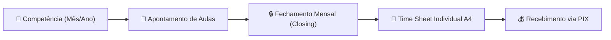
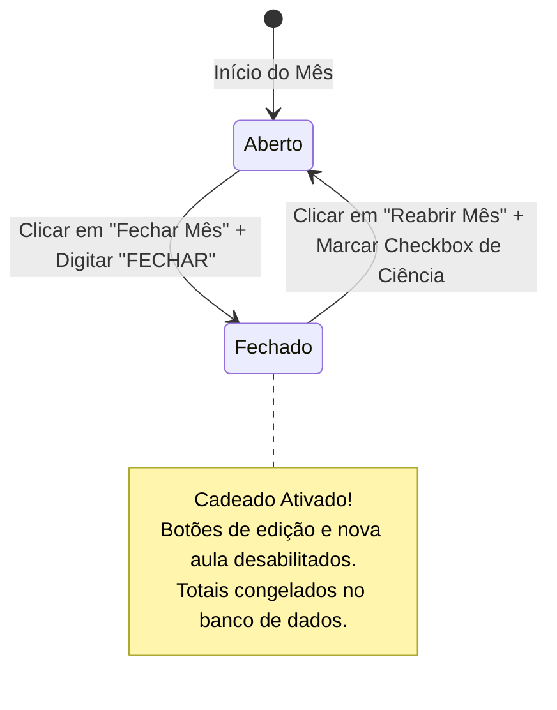
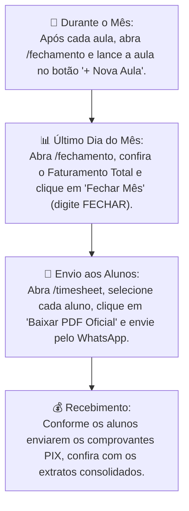

# 📖 Manual do Usuário — Painel de Atendimento Maite
> **Guia Oficial de Operação Contábil, Gestão de Alunos e Emissão de Time Sheets**  
> *Versão do Sistema: 2.1 (Atualizações de 29/Outubro/2026: Ciclo de Vida Inteligente, Lançamento Inclusivo e Histórico Fiscal Selado)*

---

## 🌟 1. Bem-vinda ao Painel Maite!

O **Painel Maite** foi desenvolvido sob medida para simplificar e profissionalizar a sua rotina como professora particular de idiomas. Ele substitui de forma definitiva as anotações em papel, controles manuais de agenda e planilhas dispersas, reunindo em uma única plataforma inteligente:

1. **Gestão Inteligente de Alunos:** Histórico cadastral, tarifas personalizadas, controle de emissão de Nota Fiscal (NF) e ciclo de vida automatizado com arquivamento e reativação sem atrito.
2. **Apontamento de Aulas & Fechamento Mensal (Closing):** Registro ágil de aulas ministradas com categorias inteligentes (aulas padrão, estendidas, cortesias, faltas cobradas ou abonadas), cálculo automático de faturamento e proteção contábil com trava mensal (Cadeado Contábil).
3. **Demonstrativo Time Sheet & PIX:** Emissão instantânea de demonstrativos individuais em formato físico padrão folha A4 com dados bancários integrados, supressão automática de colunas vazias e exportação para PDF de alta nitidez com um único clique.

---

## 🧭 2. Conceitos Importantes (Para entender em 2 minutos)

Antes de começar a navegar, conheça os termos principais utilizados no painel:



- **Competência:** É o mês e o ano que você está consultando ou movimentando (por exemplo, `Outubro de 2026`). O sistema calcula todas as receitas e horas com base na competência selecionada.
- **Preço Snapshot (`Tarifa Congelada`):** Quando você registra uma aula, o valor da sua hora naquele momento fica gravado de forma permanente naquela aula. Se você reajustar o valor do aluno meses depois, as aulas passadas **nunca** terão seus valores alterados.
- **Status da Competência (`Aberta` vs `Fechada`):**
  - **Aberta (🟢 Open):** Você pode lançar novas aulas, editar dados, alterar notas e excluir registros.
  - **Fechada / Trancada (🔒 Closed):** A competência foi selada contabilisticamente. Nenhuma aula pode ser criada, alterada ou apagada por engano, garantindo total segurança fiscal e histórica. Todo o seu histórico desde Janeiro de 2020 até Agosto de 2026 está oficialmente protegido e trancado.
- **Ciclo de Vida do Aluno (Inativação & Reativação Automáticas):**
  - **Inativação Automática (90 Dias):** Para manter sua rotina limpa, alunos que ficam sem aulas por mais de 90 dias passam automaticamente para o status **Inativo**.
  - **Reativação Automática no Agendamento:** Se um aluno inativo voltar a ter aulas, você não precisa fazer nenhum procedimento manual de reativação: basta selecionar o aluno no lançamento de aula e o sistema o **reativa na mesma hora**!
  - **Inativação Lógica:** Se um aluno parar de fazer aulas, o cadastro dele nunca é apagado fisicamente; ele fica arquivado preservando 100% das aulas passadas para consultas e relatórios.
- **Time Sheet:** É o documento formal (demonstrativo data a data) que você envia para o aluno ou responsáveis ao final do mês, contendo a discriminação das aulas, anotações de conteúdo pedagógico e seus dados bancários para transferência PIX.

---

## 📅 3. A Barra Superior (TopBar) e Navegação Global

No topo de qualquer tela do painel, você tem acesso constante ao **Seletor de Competência**:

```
+---------------------------------------------------------------------------------+
|  [Maite Logo]     📅 Competência: [ Mês: Outubro ▾ ] [ Ano: 2026 ▾ ]     (Usuária) |
+---------------------------------------------------------------------------------+
```

- **Como mudar o mês ou o ano:** Basta clicar nos seletores e escolher a competência desejada.
- **Sincronização Automática:** Ao mudar o mês na barra superior, as telas de **Fechamento** e **Time Sheet** atualizam seus números e dados imediatamente, sem que você precise recarregar a página (`F5`).

---

## 👥 4. Módulo de Alunos (`/alunos`)

A tela de Alunos é o seu catálogo central de contatos pedagógicos e contratuais.

### 4.1. Visualização Padrão Focada em Alunos Ativos
Ao acessar a tela de Alunos, a visualização inicial agora abre **automaticamente filtrada na aba "Ativos"**:
- **Rotina Mais Limpa:** Você visualiza de imediato apenas os alunos com matrículas correntes no seu dia a dia, sem a poluição de centenas de cadastros antigos.
- **Abas de Status (Tablist WAI-ARIA):**
  - **Ativos (Aba Padrão):** Exibe exclusivamente os alunos ativos.
  - **Inativos:** Exibe os alunos sem aulas recentes ou arquivados.
  - **Todos:** Exibe a base completa cadastrada.
  - Com apenas 1 clique ou usando as setas do teclado (`←` e `→`), você alterna instantaneamente entre as abas.
- **Contadores em Tempo Real:** Cada aba possui um badge com a quantidade exata de alunos em números tabulares auditáveis.
- **Busca Rápida Inteligente:** Digite qualquer parte do nome do aluno. A busca funciona mesmo se você não digitar acentos (ex.: digitar "italo" encontra "Ítalo").

### 4.2. Cadastrando um Novo Aluno (`+ Novo Aluno`)
1. Clique no botão primário **`+ Novo Aluno`** no canto superior direito.
2. Preencha o formulário modal:
   - **Nome Completo:** Digite o nome do estudante.
   - **Valor da Hora/Aula (R$):** O campo possui formatação automática em Reais. Conforme você digita os números, os centavos são posicionados automaticamente (ex.: digitar `1`, `5`, `0`, `0`, `0` vira `R$ 150,00`).
   - **Requer Emissão de Nota Fiscal (NF):** Marque esta caixa se o aluno ou a empresa contratante exige NF. Isso exibirá uma identificação roxa `NF` no cartão do aluno e na tabela de fechamento.
   - **Data da Primeira Aula:** Selecione o dia em que o aluno começou as aulas com você.
   - **Observações Gerais:** Campo livre para anotações contratuais (ex.: preferências de horário, material utilizado, restrições).
3. Clique em **`Cadastrar Aluno`**. Uma mensagem de confirmação verde aparecerá no rodapé da tela.

### 4.3. Cartão do Aluno (`StudentCard`)
Cada aluno possui um cartão com informações essenciais:
- **Nome e Badges:** Indicam se o aluno está Ativo/Inativo e se emite Nota Fiscal (`NF`).
- **Valor da Hora:** Em destaque com visual monetário.
- **Anotações:** Resumo rápido das observações contratuais.
- **Ações Rápidas:**
  - **Ver Detalhes:** Abre a página individual completa do aluno (`/alunos/:id`).
  - **Time Sheet (Ícone de Documento):** Vai direto para a folha de cobrança daquele aluno na competência ativa.
  - **Editar (Ícone de Lápis):** Abre o formulário para atualizar a tarifa ou dados cadastrais.

### 4.4. Como Inativar ou Excluir um Aluno (Salvaguarda Contábil)
Ao clicar no ícone de lixeira ou na opção de inativação:
- O sistema abrirá um **Modal de Salvaguarda**.
- **Inativação Lógica Recomendada:** Clique no botão verde em destaque **`Inativar Aluno`**. O aluno sairá da aba "Ativos", mas todas as aulas que ele já teve com você no passado continuam salvas para seus cálculos de faturamento e extratos.
- **Exclusão Física:** O botão vermelho de exclusão permanente só deve ser usado se você cadastrou o aluno por engano e ele **nunca teve nenhuma aula registrada**. Se houver aulas vinculadas, o banco de dados rejeitará a exclusão para proteger seu histórico fiscal.

---

## 🔍 5. Página de Detalhes do Aluno (`/alunos/:id`)

Ao clicar em **"Ver Detalhes"** em qualquer cartão de aluno, você entra na visão aprofundada:

```
← Voltar para Alunos   |   Alunos > Gabriela Silveira

[ Gabriela Silveira ] [ Ativo ] [ NF ]      [ Editar Cadastro ] [ Inativar ] [ Ir para Time Sheet → ]

+-----------------------------------------------------------------------------------------------+
| [ R$ 150,00 ]              [ 12/03/2024 ]          [ 38 aulas ]             [ R$ 5.700,00 ]   |
| Valor Atual Hora/Aula      Data da 1ª Aula         Total de Aulas           Faturamento Bruto |
+-----------------------------------------------------------------------------------------------+

📋 Observações Contratuais:
"Aulas focadas em conversação para negócios. Pagamento preferencial via PIX no dia 05."

📊 Histórico Completo de Aulas Ministradas:
| Data       | Categoria     | Duração | Tarifa Snapshot | Valor Calculado | Anotações Pedagógicas            |
| 14/10/2026 | Padrão (1.0x) | 1.0h    | R$ 150,00        | R$ 150,00       | Unit 4: Present Perfect Review   |
| 07/10/2026 | Estendida     | 1.5h    | R$ 150,00        | R$ 225,00       | Reposição + Unit 3 Exercises     |
```

> [!NOTE]
> Essa página possui endereço próprio na barra do navegador (ex.: `.../alunos/uuid-do-aluno`). Você pode favoritar o link, recarregar a página (`F5`) ou usar as setas de voltar/avançar do navegador sem perder nenhum dado.

---

## 🔒 6. Módulo de Fechamento Mensal / Closing (`/fechamento`)

O módulo de Fechamento é o coração financeiro do seu painel. É aqui que você acompanha tudo o que foi trabalhado no mês e sela as contas.

### 6.1. Painel de KPIs Executivos
No topo da página, 4 cartões resumem a saúde do mês ativo:
1. **Faturamento da Competência (R$):** Valor total em dinheiro gerado pelas aulas faturáveis do mês.
2. **Total de Aulas Apuradas:** Quantidade exata de aulas com tratamento singular/fracionário (ex.: `18,5 aulas`).
3. **Alunos Atendidos:** Quantos alunos distintos tiveram pelo menos uma aula no mês.
4. **Status da Competência:** Mostra uma etiqueta verde `"Aberto"` com ponto luminoso ou um selo formal `"Fechado"` com cadeado 🔒 para meses trancados.

---

### 6.2. Como Registrar uma Aula (`+ Nova Aula`) com o Seletor Inclusivo

1. Na barra de ferramentas do fechamento, clique em **`+ Nova Aula`**.
2. Preencha os campos do modal:
   - **Aluno (Seletor Inclusivo):**
     - O menu suspenso lista **todos** os alunos da sua história em ordem alfabética.
     - Se o aluno estiver inativo, ele aparece com a indicação: **`Nome do Aluno — (Inativo)`**.
     - **Aviso de Reativação Automática:** Ao selecionar um aluno inativo, um banner amigável com ícone ✨ aparece logo abaixo do campo alertando:
       > *"Este aluno está inativo há mais de 90 dias e será reativado automaticamente ao confirmar este lançamento."*
     - Você não precisa sair da tela nem reativar o aluno manualmente: ao clicar em salvar, o sistema registra a aula e o reativa instantaneamente no banco de dados!
   - **Data da Aula:** Campo de data restrito aos dias daquele mês ativo.
   - **Categoria da Aula:**
     - **Padrão (1.0x):** Aula normal de 1 hora. O sistema multiplica 1x o valor da hora.
     - **Estendida:** Aulas de 1h30 (1.5x), 2 horas (2.0x) ou reposições. O campo de multiplicador é liberado para você digitar a duração exata.
     - **Falta do Aluno:** Quando o aluno não comparece.
       > [!IMPORTANT]
       > Ao selecionar "Falta do Aluno", surge uma caixinha especial: **"Cobrar falta do aluno?"**.  
       > - Se você marcar `Sim`: a aula é faturada normalmente pelo valor integral contratado.  
       > - Se você deixar `Desmarcado`: o faturamento fica **R$ 0,00** e conta como 0 horas faturadas, mas a falta fica registrada para fins de controle e histórico.
     - **Cortesia:** Aulas demonstrativas, nivelamento ou degustação comercial. O sistema calcula automaticamente **R$ 0,00** sem gerar cobrança, preservando a anotação pedagógica.
     - **Cancelada:** Aula cancelada com antecedência pela professora. Faturamento **R$ 0,00**.
   - **Notas Pedagógicas / Conteúdo Ministrado:** Digite o resumo do que foi estudado (ex.: "Páginas 42 e 43, pronúncia de phrasal verbs, dever de casa cap. 5"). O campo possui contador de até 500 caracteres e esse texto aparecerá no Time Sheet do aluno.
3. Clique em **`Salvar Aula`**. A lista e os 4 cartões de métricas atualizam na hora! Se o aluno era inativo, a interface já reflete seu status reativado para ativo.

---

### 6.3. Tabela Consolidada em Acordeão
Abaixo dos KPIs, as aulas aparecem agrupadas por aluno:
- Cada linha exibe o nome do aluno, a quantidade de aulas faturadas, o total de horas e o valor a receber.
- **Como expandir:** Clique no nome do aluno para abrir o acordeão e ver as aulas dele dia a dia.
- **Expandir Todos / Recolher Todos:** No canto direito da tabela, você pode abrir ou fechar todos os alunos de uma vez com um só clique.
- **Ações na linha da aula:** Ao lado de cada aula, você encontra o botão de lápis (Editar) e lixeira (Excluir).

---

### 6.4. O Cadeado Contábil: Blindagem Histórica e Travas (ADR 0003)

Para evitar que você modifique aulas de um mês que já foi pago ou contabilizado, o sistema conta com o **Cadeado Contábil de Alta Fricção**:



> [!NOTE]
> **Histórico Oficial Selado:** Todas as 80 competências compreendidas entre **Janeiro de 2020 e Agosto de 2026** já estão devidamente fechadas e blindadas no painel. Ao navegar para qualquer uma dessas competências, o sistema exibe o badge `"Fechado"`, o banner informativo com cadeado e mantém os botões de inserção e edição desabilitados com tooltips explicativos.

#### Para Fechar a Competência Atual:
1. Concluídas todas as aulas do mês, clique em **`Fechar Mês`** na barra de ferramentas.
2. Um modal de segurança exibirá o resumo financeiro que será congelado.
3. Para destravar o botão de confirmação, você deve digitar textualmente em letras maiúsculas: **`FECHAR`**.
4. Clique em **`Confirmar Fechamento`**.
5. O painel exibirá o banner informativo de que o mês está trancado e desabilitará os botões de edição para sua total proteção.

#### Se precisar corrigir algo em um mês fechado (Reabertura):
1. Clique no botão **`Reabrir Mês`**.
2. Marque a caixa de seleção confirmando: *"Estou ciente do impacto contábil e confirmo que desejo destravar os lançamentos desta competência."*
3. Clique em **`Reabrir Competência`**. O mês volta ao status aberto para ajustes.

---

## 📄 7. Demonstrativo Time Sheet (`/timesheet`)

O Time Sheet é a folha oficial de prestação de contas que você envia para o aluno.

```
+-----------------------------------------------------------------------------------+
| Toolbar: Aluno: [ Gabriela Silveira ▾ ]   [ Baixar PDF Oficial ] [ Imprimir ]     |
+-----------------------------------------------------------------------------------+
|  MESA DE VISUALIZAÇÃO (PREVIEW)                                                   |
|                                                                                   |
|  +-----------------------------------------------------------------------------+  |
|  | DEMONSTRATIVO DE AULAS MINISTRADAS                   Data: 31/10/2026       |  |
|  | Time Sheet Mensal Individual                                                |  |
|  |                                                                             |  |
|  | Aluno(a): Gabriela Silveira                       Competência: 10/2026      |  |
|  | Valor Hora/Aula: R$ 150,00                                                  |  |
|  |                                                                             |  |
|  | [Tabela de Aulas com Supressão Inteligente de Colunas]                      |  |
|  | Data       Categoria       Conteúdo / Anotações         Duração     Valor   |  |
|  | 07/10/2026 Padrão (1h)     Unit 4: Phrasal Verbs        1.0h     R$ 150,00  |  |
|  | 14/10/2026 Estendida       Reposição gramatical         1.5h     R$ 225,00  |  |
|  |                                                                             |  |
|  | RESUMO DO FECHAMENTO: 2 aulas faturadas | 2.5h | TOTAL A PAGAR: R$ 375,00   |  |
|  |                                                                             |  |
|  | DADOS PARA TRANSFERÊNCIA PIX: [ Copiar Chave PIX ]                          |  |
|  | Titular: Maite Professora | Banco: Banco Inter | Chave Celular: (11) 999... |  |
|  +-----------------------------------------------------------------------------+  |
|                                                                                   |
+-----------------------------------------------------------------------------------+
```

### 7.1. Recursos Especiais do Time Sheet
- **Geometria Física DIN A4:** O documento é desenhado milimetricamente na proporção oficial de folha de papel A4 (210mm x 297mm com margens de 16mm).
- **Supressão Inteligente de Coluna:**
  - Se você preencheu anotações de conteúdo nas aulas do aluno, a tabela renderiza em **5 colunas**, exibindo a coluna de anotações.
  - Se você **não** preencheu anotações em nenhuma aula do mês daquele aluno, o sistema remove automaticamente a coluna vazia e distribui o espaço em **4 colunas**, deixando o documento visualmente harmonioso e sem espaços em branco.
- **Carimbo de Pagamento PIX:** No rodapé da folha aparecem o nome da titular, o banco, o tipo de chave e a chave PIX, acompanhados de um botão inteligente **"Copiar Chave PIX"**.
  > [!NOTE]
  > O botão "Copiar Chave PIX" e a barra de ferramentas do painel possuem a classe `.hideOnPrint`: eles **nunca** aparecem no PDF baixado nem na folha impressa!

### 7.2. Como Exportar ou Enviar o Time Sheet
1. **Baixar PDF Oficial:** Clique no botão azul **`Baixar PDF Oficial`**. O sistema compila o documento na hora e faz o download automático de um arquivo nomeado, por exemplo, `TimeSheet_Gabriela_Silveira_10_2026.pdf`.
2. **Imprimir / Salvar em PDF Vetorial:** Clique em **`Imprimir / PDF Vetorial`** (ou aperte `Ctrl + P`). A tela de impressão do seu computador se abrirá apenas com a folha A4 limpa, sem menus, barras ou cabeçalhos do site.

---

## ⚙️ 8. Configurações e Chave PIX (`/configuracoes`)

Na tela de Configurações, você gerencia os dados bancários que aparecem automaticamente em todos os seus Time Sheets:

1. Acesse o menu **Configurações**.
2. No quadro **Dados Bancários para Recebimento (PIX)**:
   - Se já houver dados cadastrados, você verá seu cartão oficial e o botão **`Editar Dados Bancários`**.
   - Se for o primeiro acesso, você verá um botão **`Cadastrar Chave PIX`**.
3. Preencha os dados:
   - **Nome do Titular da Conta:** Seu nome completo oficial.
   - **Instituição Bancária:** O nome do seu banco (ex.: Nubank, Banco Inter, Itaú, Banco do Brasil).
   - **Tipo de Chave PIX:** Escolha entre CPF, CNPJ, Celular, E-mail ou Chave Aleatória.
   - **Chave PIX:** Digite sua chave. O campo aplica máscara automática para CPF, CNPJ ou telefone, e valida e-mails e chaves aleatórias.
4. Clique em **`Salvar Dados Bancários`**. Pronto! Todos os Time Sheets emitidos a partir de agora exibirão suas informações corretas.

---

## 🗓️ 9. Rotina Operacional Recomendada (Mês a Mês)

Para ter o máximo de tranquilidade e controle financeiro, sugerimos a seguinte rotina:



---

## ❓ 10. Perguntas Frequentes & Resolução de Dúvidas (FAQ)

#### 1. "Por que ao abrir a tela de Alunos eu não vejo todos os alunos de uma vez?"
> Para o seu conforto visual e agilidade diária! O painel abre focado apenas nos alunos **Ativos** (com matrículas correntes). Se você quiser consultar um ex-aluno ou aluno inativo, basta clicar na aba **"Inativos"** ou na aba **"Todos"**.

#### 2. "Um aluno ficou mais de 3 meses sem ter aula. O que acontece com ele?"
> O sistema inativa o aluno automaticamente após **90 dias** de inatividade. Isso impede que sua lista diária fique inchada com alunos antigos. Mas fique tranquila: todas as aulas e o histórico financeiro dele permanecem 100% seguros no banco de dados.

#### 3. "Um aluno inativo voltou a ter aulas comigo. Preciso reativá-lo antes de lançar a aula?"
> **Não!** Essa é a maior novidade: no modal **`+ Nova Aula`**, o seletor lista todos os alunos. Basta escolher o aluno (ele terá o sufixo `— (Inativo)` e um aviso ✨). Ao confirmar o lançamento da aula, o sistema reativa o aluno para **Ativo** automaticamente na mesma hora!

#### 4. "O aluno faltou à aula de hoje. Como devo registrar?"
> Abra o modal **`+ Nova Aula`**, selecione o aluno, a data e na categoria escolha **`Falta do Aluno`**.  
> Se a falta estiver dentro do prazo de cancelamento gratuito e você **não** for cobrar, deixe a caixinha *"Cobrar falta do aluno?"* desmarcada (o sistema registrará R$ 0,00). Se foi em cima da hora e seu contrato prevê cobrança, marque a caixinha (o sistema cobrará o valor integral).

#### 5. "Dei uma aula experimental gratuita para um novo aluno. Devo cadastrar?"
> Sim! Registre a aula selecionando a categoria **`Cortesia`**. O sistema não cobrará nada (faturamento R$ 0,00), mas você terá o registro histórico de que a aula aconteceu e o conteúdo que foi trabalhado.

#### 6. "Tentei excluir um aluno e apareceu um aviso de erro. O que aconteceu?"
> O sistema protege você contra perdas de dados fiscais. Se esse aluno já teve aulas registradas no passado, a exclusão física é bloqueada pelo banco de dados. No próprio modal de exclusão, escolha a opção **`Inativar Aluno`**. O aluno sairá da aba de ativos, mas seu histórico de faturamento continuará 100% preservado.

#### 7. "Por que não consigo editar aulas de 2023 ou 2024?"
> Todas as competências passadas entre **Janeiro de 2020 e Agosto de 2026** foram oficialmente seladas contabilisticamente para sua segurança fiscal. Apenas meses abertos (como Outubro de 2026) permitem novas inserções ou exclusões diretas.

#### 8. "O PDF do Time Sheet fica pesado para enviar pelo WhatsApp?"
> Não! Graças à otimização de código do painel (ADR 0004), o PDF gerado é extremamente leve, limpo e rápido de baixar, perfeito para visualização direta na tela do celular dos seus alunos ou pais de alunos.

---

*Manual elaborado pela Equipe de Engenharia e Arquitetura do Painel Maite. Todos os direitos reservados.*
