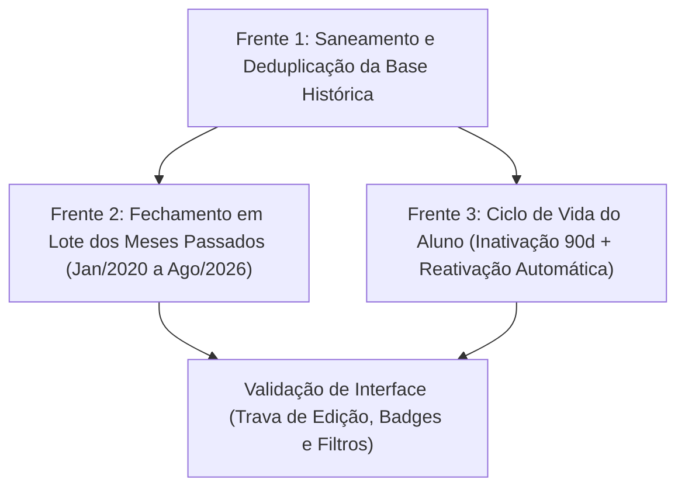

# Escopo Completo e Detalhado de Modificações do Sistema

Este documento consolida o escopo executivo e técnico resultante do alinhamento via `/grill-me`. Ele serve como especificação direta para alimentar o fluxo subsequente de **Criação de Plano de Ação**, **Boost Orchestrator** e **Organização de Planos**, sem a inclusão de código nesta etapa.

---

## 1. Visão Geral e Ordem de Precedência Técnica

As três frentes de modificação possuem uma dependência direta de execução no banco de dados e na interface:

1. **Precedência Obrigatória:** A **Deduplicação (Frente 1)** deve ser executada antes do **Fechamento em Lote (Frente 2)**, pois calcular totais contábeis em uma base com aulas duplicadas geraria faturamentos e quantidades dobradas no fechamento histórico.
2. **Independência Controlada:** O **Ciclo de Vida do Aluno (Frente 3)** pode ser estruturado em paralelo ou logo após a deduplicação, assegurando que o status dos alunos seja normalizado sobre a base limpa.

---

## 2. Detalhamento por Frente de Trabalho

### Frente 1: Deduplicação e Saneamento da Base Histórica
* **Problema Diagnosticado:** A execução dupla do conversor da planilha gerou dois conjuntos de UUIDs para os mesmos alunos e aulas, duplicando as listagens no fechamento e nas consultas de faturamento.
* **Estratégia Aprovada:** Script SQL transacional de saneamento *in-place* com salvaguarda prévia de segurança.
* **Ações e Requisitos de Escopo:**
  1. **Criação de Backup Temporário:** O script deve gerar cópias de segurança locais das tabelas de alunos e aulas antes de qualquer deleção ou atualização.
  2. **Identificação do Registro Canônico:** Para cada aluno com nome duplicado sob o mesmo proprietário, elege-se um único ID canônico (o primeiro registro gerado).
  3. **Remapeamento de Chaves Estrangeiras:** Todas as aulas vinculadas aos IDs duplicados devem ser reatribuídas para o ID canônico correspondente.
  4. **Eliminação de Aulas Duplicadas:** Identificar e remover registros de aulas que possuem exatamente os mesmos dados da aula canônica (mesmo aluno, data, categoria e multiplicador), mantendo apenas uma única ocorrência.
  5. **Remoção dos Alunos Excedentes:** Após a unificação das aulas, excluir com segurança os registros de alunos secundários/duplicados.
  6. **Auditoria Pós-Execução:** O processo deve validar que a contagem final de alunos e aulas corresponde com precisão aos dados consolidados da planilha original, executando `ROLLBACK` automático caso qualquer divergência seja detectada.

---

### Frente 2: Fechamento em Lote das Competências Históricas
* **Objetivo:** Estabelecer a integridade contábil do histórico, travando edições acidentais no passado e exibindo o status consolidado de fechamento no painel.
* **Marco de Corte Definido:** 
  * **Meses Fechados:** De **Janeiro/2020 até Agosto/2026** (inclusive).
  * **Meses Abertos:** **Setembro/2026** e **Outubro/2026** (e meses futuros), que serão alimentados e fechados manualmente pela professora.
* **Ações e Requisitos de Escopo:**
  1. **Rotina de Cálculo em Lote:** Executar procedimento em lote no banco para cada competência do período (Jan/2020 a Ago/2026) que possua aulas registradas.
  2. **Apuração de Totais Contábeis:** Utilizar a função contábil oficial do sistema para consolidar o total de aulas e a receita bruta do mês, respeitando as regras de faturamento (desconsiderando cortesias e ausências não cobradas).
  3. **Gravação na Tabela de Fechamentos:** Inserir ou atualizar os registros correspondentes na tabela de fechamentos mensais com status `closed` e data de encerramento registrada.
  4. **Bloqueio de Edição no Frontend (Regra de Negócio):**
     * Exibir a badge visual verde de **"Fechado"** nas competências históricas.
     * Desabilitar/ocultar opções de adicionar novas aulas, editar aulas existentes ou excluir lançamentos que pertençam a competências marcadas como fechadas.
     * Manter ativas e editáveis apenas as competências abertas (Setembro/2026 em diante).

---

### Frente 3: Ciclo de Vida Inteligente dos Alunos (Inativação e Reativação)
* **Objetivo:** Manter a listagem principal limpa sem exigir manutenção manual de cadastros, permitindo lançar aulas para qualquer aluno e reativando-o instantaneamente sem fricção.
* **Arquitetura Aprovada:** Lógica centralizada diretamente no banco de dados via PostgreSQL (Trigger atômico e Procedimento de Sincronização), evitando requisições manuais duplas pelo frontend.
* **Ações e Requisitos de Escopo:**
  1. **Regra de Inativação Automática (90 Dias):**
     * Um aluno deve ser classificado como `inactive` se a data de sua última aula registrada for superior a 90 dias em relação à data atual.
     * Alunos recém-cadastrados há mais de 90 dias que nunca tiveram nenhuma aula lançada também devem ser marcados como `inactive`.
     * A sincronização deve ocorrer de forma automática e transparente ao carregar a aplicação/telas relevantes através de rotina no banco.
  2. **Reativação Automática no Lançamento:**
     * Implementação de gatilho (*trigger*) no banco de dados associado à inserção de novas aulas.
     * Ao salvar uma nova aula para um aluno que esteja `inactive`, o banco atualiza automaticamente seu status para `active` na mesma transação.
     * Não há necessidade de o usuário alterar manualmente o cadastro antes de lançar a aula.
  3. **Experiência do Usuário (Frontend):**
     * **Modal de Nova Aula:** O campo de seleção de aluno deve listar **todos os alunos** (ativos e inativos). Os alunos inativos devem ser sinalizados com um indicador visual sutil (ex.: `Nome do Aluno (Inativo)`), permitindo sua seleção direta e sem restrições.
     * **Tela de Gestão de Alunos:** A listagem principal deve exibir **por padrão apenas os alunos Ativos**. A tela deve fornecer abas ou filtros rápidos para visualizar "Inativos" ou "Todos", permitindo consultas e auditorias quando desejado.

---

## 3. Matriz de Entregáveis por Camada

| Camada | Frente 1 (Deduplicação) | Frente 2 (Fechamento em Lote) | Frente 3 (Ciclo de Vida Alunos) |
| :--- | :--- | :--- | :--- |
| **Banco de Dados (PostgreSQL / Supabase)** | Script transacional de backup, remapeamento de IDs canônicos e deleção de duplicatas. | Script de processamento em lote chamando a função contábil para Jan/2020 até Ago/2026. | Procedimento de sincronização dos 90 dias (`inactive`) + Trigger atômico ao inserir aula (`active`). |
| **Camada de Dados / Hooks** | Verificação de integridade dos IDs retornados pelas consultas. | Consulta ao status do mês para determinar se o período está bloqueado para mutações. | Chamada à rotina de sincronização de status e atualização reativa do cache de alunos. |
| **Interface do Usuário (React UI)** | Exibição correta de apenas uma linha por aluno no fechamento e nos relatórios. | Badge verde "Fechado" e desativação dos formulários/botões de edição em meses históricos. | Tag `(Inativo)` no seletor de alunos do formulário de aula + abas de filtro (Ativos / Inativos / Todos) na lista geral. |

